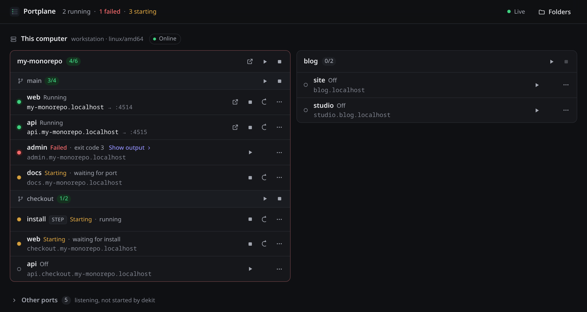

# Portplane

> Every dev server, on every machine, in one window.

See which local dev servers are running across all your project folders, and across your other machines over SSH. Open them at stable `https://<name>.localhost` URLs, and start or stop them with a click. Built on top of [dekit](https://dekit.run) and [portless](https://github.com/vercel-labs/portless), not instead of them.

**Status:** early development, not ready for daily use yet. The [roadmap](docs/roadmap.md) tracks the way to v1.0. The single-machine prototype that started the project lives in [`prototype/`](prototype/README.md).



## Install

```sh
curl -fsSL https://akamachinecode.github.io/portplane/install.sh | sh      # macOS, Linux
irm https://akamachinecode.github.io/portplane/install.ps1 | iex            # Windows (beta)
```

Or download the macOS app (`.dmg`), `.deb`, `.rpm` or `.zip` from [Releases](https://github.com/akamachinecode/portplane/releases). See the [install guide](docs/install.md) for first-launch prompts and verifying downloads.

## Use it

```sh
portplane folders add ~/code   # where your projects (and their dekit.yaml) live
portplane                      # opens https://portplane.localhost, with a menu-bar or tray icon
portplane setup ~/code         # no dekit config yet? propose one for every app it finds
portplane ls                   # the same view in the terminal
portplane restart shop/web     # start, stop or restart an app or a whole project ("shop/")
portplane autostart on         # start at login
```

Add other machines from the window (**Machines**): any host in `~/.ssh/config` or your Tailscale network. Their apps open at `https://<app>.<machine>.localhost`.

Without dekit or portless, Portplane still lists the ports open on your machine and the folder each one serves.

## Read more

- [Vision](docs/vision.md)
- [Field notes](docs/field-notes.md): what wiring dekit and portless by hand taught us
- [Open questions](docs/open-questions.md)
- [Roadmap to v1.0](docs/roadmap.md)
- [Architecture decision records](docs/adr/README.md)
- [Upstream proposals](docs/upstream.md)
- [Security model](docs/security.md) · [Troubleshooting](docs/troubleshooting.md)

## Contributing

See [CONTRIBUTING.md](CONTRIBUTING.md). Security issues: [SECURITY.md](SECURITY.md).

## License

[Apache-2.0](LICENSE)
