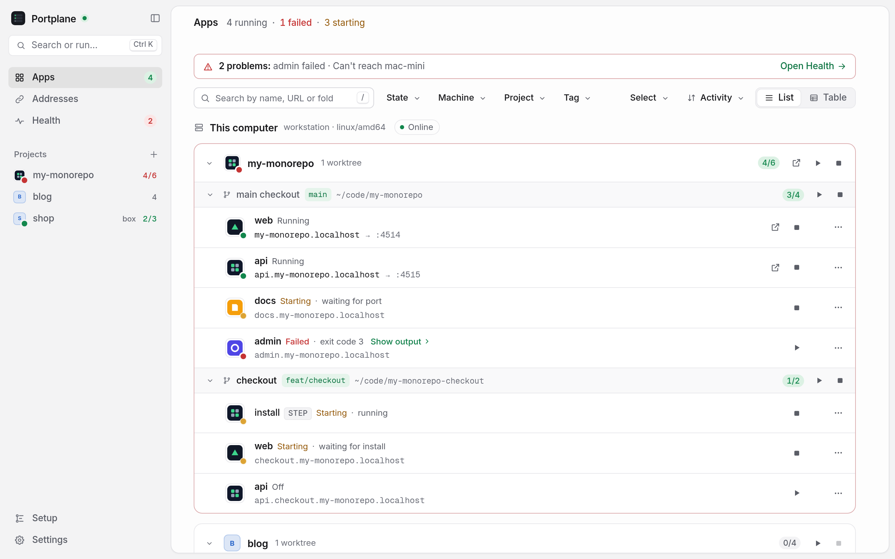

<div align="center">


# Portplane

**Every dev server, on every machine, in one window.**

Stop hunting for `localhost:51xx`. Portplane shows every dev server across your projects and your other machines, gives each one a stable `https://<name>.localhost` address, and starts or stops it with a click.

[**Download**](https://akamachinecode.github.io/portplane/#download) · [Website](https://akamachinecode.github.io/portplane/) · [Docs](https://akamachinecode.github.io/portplane/docs/) · [Changelog](CHANGELOG.md)

[](https://github.com/akamachinecode/portplane/releases/latest)
[](LICENSE)


</div>

<picture>
  <source media="(prefers-color-scheme: dark)" srcset="docs/images/portplane-dark.png">
  
</picture>

## Why Portplane

You run a website, an admin, an API and a docs site, across a few monorepos and a couple of git worktrees, some on your laptop and some on a box under your desk. Ports collide, ports move, bookmarks break, and the only way to know what is running is to read terminal output.

Portplane fixes that in one window:

- **One address per app, forever.** `https://shop.localhost`, `https://api.shop.localhost`, `https://checkout.shop.localhost` for a worktree. Real HTTPS, a trusted certificate, no port numbers to remember.
- **Everything at a glance.** Every app's state (on, starting, failed, off), grouped by project and worktree, on this computer and on every machine you reach over SSH.
- **One click to act.** Start, stop or restart an app or a whole project. When something fails, its last lines of output are right there, ready to copy.
- **Set up in five minutes, no terminal.** Point it at a folder: Portplane finds your apps, installs what's missing, proposes an address for each and writes plain config after you review it.

## Features

| | |
|---|---|
| **Apps** | Live state for every dev server, grouped by project and git worktree. Pin favourites, search everything with <kbd>Ctrl</kbd>/<kbd>⌘</kbd> <kbd>K</kbd>, see each app's live output. |
| **Addresses** | Stable `.localhost` URLs over HTTPS. Rename an app's address in a click, clean up stale ones, add aliases. |
| **Remote machines** | Add any host from `~/.ssh/config` or your Tailscale network. Its apps open at `https://<app>.<machine>.localhost`, through SSH, as if they were local. |
| **Sharing** | Share an app with your tailnet, publicly with Tailscale Funnel, ngrok or Cloudflare, or open it from your phone on the same Wi-Fi. |
| **Health** | Failed apps, stopped runners, certificate and proxy problems in one place, each with its fix. |
| **Guided setup** | Installs dekit, portless and Node.js for you, sets up HTTPS and browser trust, then finds and configures your apps. On remote machines too. |
| **Docker Compose** | Start, stop and open compose projects with stable addresses. |
| **Native everywhere** | A menu-bar app on macOS, its own window and tray icon on Linux and Windows. |

## Download

| | |
|---|---|
| **macOS** 12+ | [Apple silicon and Intel `.dmg`](https://akamachinecode.github.io/portplane/#download-mac) |
| **Linux** | [`.deb`, `.rpm` or `.tar.gz`, x86-64 and ARM64](https://akamachinecode.github.io/portplane/#download-linux) |
| **Windows** 10/11 (beta) | [`.zip`, x64 and ARM64](https://akamachinecode.github.io/portplane/#download-windows) |

Or from a terminal:

```sh
curl -fsSL https://akamachinecode.github.io/portplane/install.sh | sh      # macOS, Linux
irm https://akamachinecode.github.io/portplane/install.ps1 | iex            # Windows
```

Every release has cosign-signed checksums. The [install guide](https://akamachinecode.github.io/portplane/docs/) covers first-launch prompts and verifying downloads.

## Quick start

Open Portplane and follow the guided setup. Or from a terminal:

```sh
portplane folders add ~/code   # where your projects live
portplane                      # opens the window, with a menu-bar or tray icon
portplane setup ~/code         # no dekit config yet? propose one for every app it finds
portplane ls                   # the same view in the terminal
portplane restart shop/web     # start, stop or restart an app or a whole project ("shop/")
portplane autostart on         # start at login
```

## Built on tools you already trust

Portplane doesn't run your servers and doesn't replace anything. It sits on two small open-source tools:

- **[dekit](https://dekit.run)** runs and supervises your dev servers.
- **[portless](https://github.com/vercel-labs/portless)** gives them stable `.localhost` addresses through a local HTTPS proxy.

And it keeps three promises:

- **Local-first.** No accounts, no cloud, no telemetry.
- **Nothing listening on your network.** The UI lives on loopback; other machines are reached only over SSH, with your keys. See the [security model](https://akamachinecode.github.io/portplane/docs/security/).
- **No lock-in.** The config it writes is plain dekit YAML you can keep using without Portplane.

Without dekit or portless, Portplane still lists the ports open on your machine and the folder each one serves.

## Status

Portplane is young (v0.x) and moving fast towards v1.0: expect rough edges, and tell us about them in [Issues](https://github.com/akamachinecode/portplane/issues). The [roadmap](docs/roadmap.md) shows what's next.

## Learn more

- [Documentation](https://akamachinecode.github.io/portplane/docs/): install, troubleshooting, security model
- [Vision](docs/vision.md) and [roadmap](docs/roadmap.md)
- [Architecture decision records](docs/adr/README.md) · [Field notes](docs/field-notes.md) · [Upstream proposals](docs/upstream.md)

## Contributing

Contributions are welcome: see [CONTRIBUTING.md](CONTRIBUTING.md). Report security issues privately: [SECURITY.md](SECURITY.md).

## License

[Apache-2.0](LICENSE)
